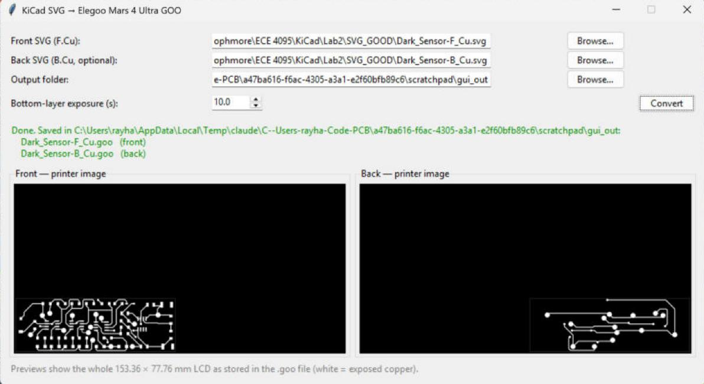

# KiCad2GOO: KiCad copper SVG → Elegoo Mars 4 Ultra `.goo`

One-click replacement for the Inkscape + UVtools steps of the PCB photoresist workflow.
Pick the F.Cu SVG (and optionally the B.Cu SVG) exported from KiCad, click **Convert**, and get
`.goo` files ready for the Elegoo Mars 4 Ultra. Inkscape and UVtools are not needed.



---

## Getting started, step by step

### Step 1: Download the app (once)

Open the **[latest release](https://github.com/MottoBoss/kicad2goo/releases/latest)**. Under **Assets**,
download the file for your computer.

**Windows 10/11**

1. Download **`KiCad2GOO-windows.exe`**. Put it anywhere (Desktop, Documents…). Nothing needs installing.
2. Double-click it. The first start takes about 5 seconds.
3. If Windows shows **"Windows protected your PC"**, click **More info → Run anyway**. The app is not code-signed,
   so Windows warns about every unsigned download.

**macOS**

1. Check your chip: Apple menu → **About This Mac**. "Apple M1/M2/M3/M4" → download
   **`KiCad2GOO-macos-apple-silicon.zip`**; "Intel" → download **`KiCad2GOO-macos-intel.zip`**.
2. Double-click the zip to unzip it. Drag **KiCad2GOO.app** into **Applications** (optional).
3. **First launch only:** right-click (or Control-click) the app → **Open** → **Open**. The app is not signed,
   so double-clicking the first time gives a warning with no Open button.
4. If macOS says the app **"is damaged"**, open **Terminal** and run this once, then open the app again:
   ```bash
   xattr -dr com.apple.quarantine /Applications/KiCad2GOO.app
   ```

> Can't see the Releases page? The repository is private, so the owner must add you as a collaborator
> (Settings → Collaborators) or make the repository public.

### Step 2: Export the copper layers from KiCad

1. Open your board in the **PCB Editor**.
2. **File → Plot…**
3. **Plot format:** `SVG`. **Output directory:** any folder you like.
4. **Include Layers:** tick **F.Cu**. Also tick **B.Cu** for a double-sided board. Untick everything else.
5. **Plot on All Layers:** tick **Edge.Cuts** only.
6. **General Options:**

   | Option | Setting |
   |---|---|
   | Plot drawing sheet | off |
   | **Negative plot** | **on** (required; the app refuses positive plots) |
   | **Mirrored plot** | **on** (the output orientation is calibrated for this) |
   | Drill marks | None |
   | Scaling | 1:1 |

7. **SVG Options → Output mode:** `Black and white`.
8. Click **Plot**. You get `YourBoard-F_Cu.svg` (and `YourBoard-B_Cu.svg`) in the output directory.

### Step 3: Convert

1. Open **KiCad2GOO**.
2. **Front SVG (F.Cu):** click **Browse…** and pick `…-F_Cu.svg`.
3. **Back SVG (B.Cu, optional):** pick `…-B_Cu.svg`, or leave it empty for a single-sided board.
4. **Output folder:** filled in automatically with the SVG folder. Click **Browse…** to choose another one,
   e.g. the printer's USB stick.
5. **Bottom-layer exposure (s):** 10 by default. Change it only if your exposure tests say so.
6. Click **Convert**. It takes 10–60 seconds per side depending on board size.
7. A green **Done** message lists the files saved (`YourBoard-F_Cu.goo`, `YourBoard-B_Cu.goo`). The previews show the
   whole printer screen: front board bottom-left, back board bottom-right.

### Step 4: Print

1. Copy the `.goo` file(s) to the Mars 4 Ultra's USB stick and select them on the printer as usual.
2. For a double-sided board, the front and back images are mirror images of each other about the screen's
   vertical centre line. Between the two exposures, flip the board left↔right and place it in the opposite
   corner, as with your existing UVtools-made files. The pads and vias then line up.

### If something goes wrong

| Message / symptom | What to do |
|---|---|
| *No negative-plot background found…* | Turn on **Negative plot** in KiCad's Plot dialog and plot again. |
| *board is about X x Y mm; the Mars 4 Ultra can expose at most 153.36 x 77.76 mm* | The board is too big for the printer screen. A board taller than 77.76 mm must be rotated in KiCad. |
| *Front and back look swapped…* | Put the F_Cu file in **Front** and the B_Cu file in **Back**. |
| *… is not a valid SVG file* | You picked a file that isn't the KiCad SVG. |
| *Output folder does not exist* | Pick an existing folder with **Browse…**. |
| *Bottom-layer exposure must be a number…* | Type a number of seconds, e.g. `10`. |
| Board looks mirrored compared with before | Check that **Mirrored plot** was on when you plotted. |

---

## Running from source (any OS, for developers)

1. Install **Python 3.11 or newer** from [python.org](https://www.python.org/downloads/). On Windows tick
   **"Add python.exe to PATH"** in the installer. The python.org installers include Tk, which the window needs.
2. Get the code: on GitHub click **Code → Download ZIP** and unzip it, or clone it:
   ```bash
   git clone https://github.com/MottoBoss/kicad2goo.git
   ```
3. Open a terminal in the project folder and create a virtual environment:
   ```bash
   python -m venv .venv
   ```
4. Activate it. Windows: `.venv\Scripts\activate`; macOS: `source .venv/bin/activate`. Then install:
   ```bash
   pip install -r requirements.txt
   ```
5. Start the app:
   ```bash
   python app.py
   ```
   Or convert from the command line:
   ```bash
   python pcb2goo.py --front Board-F_Cu.svg --back Board-B_Cu.svg --out OUTPUT_DIR --bottom-exposure 10
   ```

### Building the app

* **Locally** (makes `dist/KiCad2GOO.exe` on Windows, `dist/KiCad2GOO.app` on macOS; PyInstaller only
  builds for the OS it runs on):
  ```bash
  pip install pyinstaller==6.22.3
  ```
  ```bash
  pyinstaller --noconfirm --onefile --windowed --name KiCad2GOO app.py
  ```
* **On GitHub:** every push runs [.github/workflows/build.yml](.github/workflows/build.yml). On Windows, an
  Apple-Silicon Mac and an Intel Mac, it converts `samples/*.svg`, checks the result matches `samples/*.goo`,
  and builds the app. The builds are downloadable from the run's **Artifacts** (Actions tab).
* **Publishing a new release:** tag a version and push the tag. The workflow then attaches all three apps to a new
  release on the Releases page (Step 1's download link).
  ```bash
  git tag v1.0.1
  ```
  ```bash
  git push origin v1.0.1
  ```

---

## What the converter does

| Step | Detail |
|---|---|
| Rasterize | Only KiCad's negative-plot area is rendered (the same area Inkscape's *Selection* export used), at exactly 18 µm per pixel (= 1411.11 DPI), anti-aliased with 4×4 supersampling. |
| Polarity | White copper → 255 (UV on); black → 0. Same grey values UVtools gets when importing the PNG. |
| Crop | Trimmed to the exposed area, which is the board outline. Same result as UVtools *Move*. |
| Front (F.Cu) | Rotated 180°, flush in the **bottom-left** corner of the stored image (same pixels as `Rayhaan_Lab2.goo`). |
| Back (B.Cu) | Flipped vertically, flush in the **bottom-right** corner (same pixels as `Back.goo`). |
| Size check | Boards larger than 153.36 × 77.76 mm are rejected with a clear message. |

"Bottom-left" means image coordinates as stored in the file. UVtools may display it differently, because its
*auto flip layer if mirrored* view option flips the preview.

### Printer settings written (copied from the working reference files)

| Parameter | Value |
|---|---|
| Resolution / pixel | 8520 × 4320 px, 18 µm, display 153.36 × 77.76 mm, mirror X |
| Layers | 1 layer, 0.1 mm, bottom-layer count 10 (the single layer is a bottom layer) |
| Exposure | **bottom 10 s** (editable in the app), normal 3 s, light PWM 255 |
| Lift / retract | 6 mm @ 100 mm/min (second stage 0 mm @ 300 / 80 mm/min), wait times 0 |
| Anti-aliasing | 8-bit greyscale (grey level 1), as in the references |
| Machine name | `UVtools Prusa SL1S SPEED`, the same header strings as the working files |

To change a fixed value, edit the `HEADER` / `LAYER` tables at the top of [pcb2goo.py](pcb2goo.py).

## Platform status

| Platform | Status |
|---|---|
| Windows 11 (x64) | **Tested**: source and the packaged `KiCad2GOO.exe` |
| macOS Apple Silicon / Intel | Built and conversion-checked by GitHub Actions on every push. The app window itself has not been tried on a Mac. |
| Physical printer | **Not tested**. Files are validated against the reference `.goo` files and by UVtools 7.0.0, not on a Mars 4 Ultra. |

## Validation

`python validate.py` re-runs every check: GOO codec, rasterization vs Inkscape, comparison with the reference
`.goo` files, double-sided registration, UVtools decoding, and other boards (KiCad demo projects plus
synthetic size-limit cases). Inputs come from this repo. UVtools, Inkscape and `kicad-cli` are found at their
default Windows locations or via the `UVTOOLS_CMD`, `INKSCAPE` and `KICAD_CLI` environment variables; tests
whose tool is missing are skipped. Results and explanations are in [VALIDATION.md](VALIDATION.md).

## Files

| File | Purpose |
|---|---|
| `pcb2goo.py` | Conversion engine (SVG raster, placement, GOO encoder/decoder) + command line |
| `app.py` | Desktop GUI (Tkinter) |
| `validate.py` | Validation suite (Tests A–E) |
| `samples/` | Dark_Sensor KiCad SVGs, their Inkscape PNGs, the generated `.goo` files, comparison images |
| `Rayhaan_Lab2.goo`, `Back.goo` | Known-working reference files made with Inkscape + UVtools |
| `.github/workflows/build.yml` | GitHub build: Windows + macOS apps, release on version tags |
