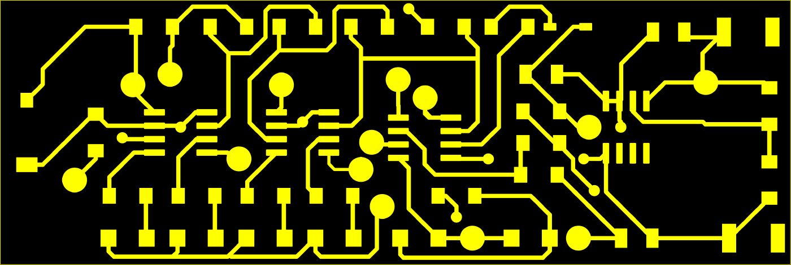
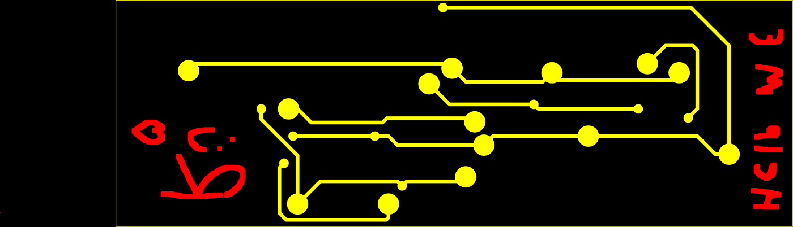

# Validation report: KiCad2GOO

**Date:** 2026-10-13.
**Machine:** Windows 11 (x64), Python 3.11.9, numpy 2.4.6, Pillow 12.3.0, resvg-py 0.5.0.
**Independent tools used as judges:** UVtools 7.0.0 (`UVtoolsCmd`), Inkscape 1.4.4, KiCad 10.0.6 `kicad-cli`.

Re-run everything with `python validate.py`. The full output of the final run is in
[validation_output.md](validation_output.md).

## Summary

| Test | What was checked | Result |
|---|---|---|
| Codec | GOO RLE encode/decode; re-encoding both reference layers | **Byte-identical** to UVtools' own encoding |
| A | SVG → raster vs your Inkscape PNGs, same export window | 99.99% / 99.997% of pixels within 16/255; cropped size identical (±1 px) |
| B | Front `.goo` vs `Rayhaan_Lab2.goo` | Same pixels occupied; 99.86% within 16/255; total exposure −0.07% |
| C | Back `.goo` vs `Back.goo` | Same pixels occupied; 99.93% within 16/255 outside your hand-drawn marks |
| Registration | Front vs back, double-sided | Pads/vias coincide at offset (0,0) when the board is flipped left↔right |
| D | File validity | Structure, checksum, 8520×4320, 1 layer, 10/3 s; **UVtools 7.0.0 opens both files and decodes identical images** |
| E | 6 KiCad demo boards (both sides) + 3 synthetic boards | All 7 fitting SVGs convert, land in the corner and match Inkscape (99.95–99.996% within 16/255, size ±1 px); all 8 oversize SVGs rejected with a clear message |
| GUI | Packaged `KiCad2GOO.exe` driven on the desktop | Converts both sides; output identical to the command line except the timestamp |
| Cross-platform | GitHub Actions: Windows, macOS Apple Silicon, macOS Intel | Converter output pixel-identical on all three; all three apps build |
| Printer | Physical print on a Mars 4 Ultra | **Not tested** |

## 1. What the reference files revealed

Both references were decoded with my decoder and with UVtools (identical images). Findings:

* **Format.** GOO V3.0, big-endian: a 195,477-byte header (two RGB565 previews), one 70-byte layer record,
  an RLE layer stream (`0x55` start byte, checksum byte at the end), and an 11-byte footer.
  Field layout is from UVtools' `GooFile.cs`. My encoder reproduces the reference RLE streams byte-for-byte.
* **The layer is 8-bit greyscale.** The anti-aliased edges of the Inkscape PNG are kept, not thresholded.
* **UVtools' import is lossless.** Outside the hand-drawn marks, `Back.goo` equals your Inkscape PNG flipped
  vertically: 0 of 5,382,965 pixels differ. So matching the Inkscape raster is all it takes to match the printer file.
* **Placement in stored-image coordinates** (row 0 = top of the image in the file):

  | Side | Transform of the SVG image | Corner | Pixels occupied |
  |---|---|---|---|
  | Front (`Rayhaan_Lab2.goo`) | rotated 180° | bottom-left | x 0–4142, y 2927–4319 |
  | Back (`Back.goo`) | flipped vertically | bottom-right | x 4377–8519, y 2927–4319 |

  Your brief describes this as "top-left / top-right" and lists only a vertical flip for B.Cu. The references
  were treated as authoritative, as you asked. Your UVtools has *Auto flip layer if mirrored* enabled, so its
  on-screen view is not the stored image. The two placements are mirror images about the LCD's vertical
  centre line (x′ = 8519 − x). That is exactly what double-sided registration needs: expose F.Cu in the
  bottom-left corner, flip the board left↔right, push it into the bottom-right corner, expose B.Cu. Your two
  reference files, made two weeks apart, register at offset (0,0) under this rule. So do the generated ones.
* **Printer parameters** (both references agree unless noted):

  | Parameter | Rayhaan_Lab2.goo | Back.goo | Generated |
  |---|---|---|---|
  | Resolution | 8520 × 4320 | 8520 × 4320 | 8520 × 4320 |
  | Display size (mm) | 81 × 128 ✗ | 153.36 × 77.76 | **153.36 × 77.76** |
  | Mirror | X | X | X |
  | Layers / layer height | 1 / 0.1 mm | 1 / 0.1 mm | 1 / 0.1 mm |
  | Bottom layer count | 10 | 10 | 10 |
  | Bottom exposure | 10 s | 9.5 s ✗ | **10 s** (as specified; editable) |
  | Normal exposure | 3 s | 3 s | 3 s |
  | Lift / retract | 6 mm @ 100 mm/min | same | same |
  | Lift2 / retract2 | 0 mm @ 300 / 80 | same | same |
  | Light PWM, AA, grey level | 255, 8, 1 | same | same |
  | Machine / software strings | `UVtools Prusa SL1S SPEED`, UVtools 7.0.0 | same | same |

  The front reference's 81 × 128 mm display size is a leftover from the UVtools SL1S demo file: it makes UVtools
  think pixels are 9.5 × 29.6 µm. I used the correct Mars 4 Ultra size from `Back.goo`. Bottom exposure is 10 s
  as you specified; `Back.goo` contains 9.5 s.
* **Inkscape "Selection" export.** The selection is KiCad's negative-plot background rectangle (board bounding
  box plus about 5 mm). Inkscape stretches that window onto a whole number of pixels and stores a slightly
  adjusted DPI: F.Cu PNG 4742 px at ≈1411.0 DPI, B.Cu 4743 px at ≈1411.1 DPI. Rendering the whole 297 × 210 mm page
  instead would give a 16,500 × 11,667 px image that does not fit the printer. The converter renders only that
  rectangle, at exactly 18 µm per pixel, and then crops to the exposed area as UVtools' *Move* did.

## 2. Test A: rasterization vs Inkscape (same window, same pixel grid)

| Side | Exact | Within 16/255 | Mean abs diff | Max | Total exposure | Cropped size (mine / Inkscape) |
|---|---|---|---|---|---|---|
| F.Cu (4742×2166) | 99.100% | 99.988% | 0.044 | 77 | −0.03% | 4143×1393 / 4142×1393 |
| B.Cu (4743×2166) | 99.467% | 99.997% | 0.026 | 69 | −0.03% | 4143×1393 / 4143×1393 |

Remaining differences are anti-aliased edge pixels only. There are no differences on the board outline, and the
geometry overlays exactly. The few pixels with differences above 16/255 sit at the tips of round trace caps, where
cairo (Inkscape) and resvg approximate the curve slightly differently: under 0.2 px, about 3 µm. resvg on its own
anti-aliases with 16 levels, so the converter averages 4×4 sub-pixels. That cut the mean error from 0.14 to 0.04
grey levels (the trade-off is ~12 s per side; `SUPERSAMPLE` in `pcb2goo.py`). The F.Cu 1-px width difference
comes from Inkscape's 1411.0 DPI export; the converter uses the true 18 µm pitch.

## 3. Tests B and C: generated `.goo` vs references

*Front: red = only in `Rayhaan_Lab2.goo`, green = only in the generated file, yellow = both.*

*Back: red strokes are hand-drawn marks in `Back.goo` (pixel editor), not part of the SVG.*

| | Front | Back |
|---|---|---|
| Occupied pixels (bounding box) | identical (x 0–4142, y 2927–4319) | identical (x 4377–8519, y 2927–4319) |
| Pixels within 16/255 | 99.864% | 99.933% (outside hand marks) |
| Exact pixels | 99.716% | 99.839% (outside hand marks) |
| Total exposure vs reference | −0.07% | −0.06% (outside hand marks) |
| Header fields that differ | display size (see §1) | bottom exposure 9.5 → 10 s (see §1) |
| Layer record fields that differ | none | exposure 9.5 → 10 s |

**Differences that cannot be eliminated, and why:**

1. **Hand-drawn marks in `Back.goo`.** About 146,700 px of strokes ("c:", "6", a heart, text along the right edge)
   plus 18 stray pixels at x≈3670, outside the board, came from the UVtools pixel editor. They are not in the SVG,
   and the converter does not invent them. They explain all of `Back.goo`'s extra 22.9 → 18.2 mm³ "volume".
2. **The front reference came from an earlier Inkscape export.** `Rayhaan_Lab2.goo` was made on Sept 24, before the
   Oct 7 PNGs, with a slightly different sub-pixel phase. Even your own Oct 7 Inkscape PNG, placed exactly as
   UVtools did, matches it worse than the converter does: mean diff 0.153 vs 0.058; 99.83% vs 99.86% within 16/255.
3. **Anti-aliasing levels at edges** (§2): a few µm, far below the LCD's 18 µm pixel.
4. **Metadata:** time stamp; previews (now a picture of your board instead of the UVtools demo images);
   volume/material/print-time estimates, which are informational and use the formulas UVtools applies.

## 4. Test D: file validity

For both generated files (`samples/Dark_Sensor-F_Cu.goo`, `samples/Dark_Sensor-B_Cu.goo`):

* Header layout V3.0, `LayerDefAddress` = 195,477, magic and footer present; decodes with a valid RLE checksum.
* 8520 × 4320, 1 layer, bottom layer count 10, bottom exposure 10 s in both header and layer record, normal 3 s.
* **UVtools 7.0.0** (`UVtoolsCmd extract` / `print-properties`) opens both files and decodes a layer image
  pixel-identical to the converter's. It reports 18 µm pixels, display 153.36 × 77.76 mm, board 74.57 × 25.07 mm,
  exposure "10/3s".
* UVtools' issue scan reports only `TouchingBound`. That is expected: the board sits flush in the corner, as in
  your workflow (no margin).

## 5. Test E: other boards

KiCad demo projects were exported with `kicad-cli` using your exact Plot settings: negative, mirrored, black and
white, no drill marks, Edge.Cuts on all layers. I first confirmed that `kicad-cli` output for your own board is
identical to your GUI export, except for a slightly larger background rectangle. Synthetic boards add a
near-maximum size (150 × 75 mm with an arc track, a zone with a hole, pads and traces) and two just-oversize cases.
Every converted SVG was also rendered by the Inkscape CLI for comparison.

| Board | Side | Plot area (mm) | Result | Exposed size (mm) | vs Inkscape CLI (same SVG) |
|---|---|---|---|---|---|
| ecc83-pp | back | 65.8 x 59.4 | GOO OK, in corner | 52.200 x 46.512 | 99.31% exact, 99.990% within 16/255, size diff -1/+0 px |
| ecc83-pp | front | 65.8 x 59.4 | GOO OK, in corner | 52.200 x 46.512 | 99.68% exact, 99.996% within 16/255, size diff -1/+0 px |
| StickHub | back | 29.0 x 62.0 | GOO OK, in corner | 16.614 x 40.122 | 98.90% exact, 99.948% within 16/255, size diff +0/+0 px |
| StickHub | front | 29.0 x 62.0 | GOO OK, in corner | 16.614 x 40.122 | 99.03% exact, 99.951% within 16/255, size diff +0/+0 px |
| RoyalBlue54L-Feather | back | 72.3 x 42.8 | GOO OK, in corner | 58.536 x 24.588 | 98.67% exact, 99.978% within 16/255, size diff +0/+0 px |
| RoyalBlue54L-Feather | front | 72.3 x 42.8 | GOO OK, in corner | 58.536 x 24.588 | 98.45% exact, 99.960% within 16/255, size diff +0/+0 px |
| pic_programmer | back | 181.3 x 127.1 | rejected: pic_programmer-bottom_layer.svg: board is about 160 x 99 mm; the Mars 4 Ultra can expose at most 153.36 x 77.76 mm. |  | Inkscape: exposed area 160.1 x 99.2 mm (too large) |
| pic_programmer | front | 181.3 x 127.1 | rejected: pic_programmer-top_layer.svg: board is about 160 x 99 mm; the Mars 4 Ultra can expose at most 153.36 x 77.76 mm. |  | Inkscape: exposed area 160.1 x 99.2 mm (too large) |
| interf_u | back | 149.4 x 127.9 | rejected: interf_u-bottom_copper.svg: board is about 116 x 108 mm; the Mars 4 Ultra can expose at most 153.36 x 77.76 mm. |  | Inkscape: exposed area 115.7 x 108.4 mm (too large) |
| interf_u | front | 149.4 x 127.9 | rejected: interf_u-top_copper.svg: board is about 116 x 108 mm; the Mars 4 Ultra can expose at most 153.36 x 77.76 mm. |  | Inkscape: exposed area 115.7 x 108.4 mm (too large) |
| tinytapeout-demo | back | 142.1 x 118.0 | rejected: tinytapeout-demo-B_Cu.svg: board is about 105 x 81 mm; the Mars 4 Ultra can expose at most 153.36 x 77.76 mm. |  | Inkscape: exposed area 104.6 x 81.1 mm (too large) |
| tinytapeout-demo | front | 142.1 x 118.0 | rejected: tinytapeout-demo-F_Cu.svg: board is about 105 x 81 mm; the Mars 4 Ultra can expose at most 153.36 x 77.76 mm. |  | Inkscape: exposed area 104.6 x 81.1 mm (too large) |
| synthetic 150 x 75 mm | front | 160.0 x 85.0 | GOO OK, in corner | 150.066 x 75.060 (drawn 150.05 x 75.05) | 99.81% exact, 99.991% within 16/255, size diff +0/+0 px |
| synthetic 154 x 50 mm | front | 164.0 x 60.0 | rejected: synthetic-154x50-F_Cu.svg: board is about 154 x 50 mm; the Mars 4 Ultra can expose at most 153.36 x 77.76 mm. |  | Inkscape: exposed area 154.1 x 50.0 mm (too large) |
| synthetic 60 x 100 mm | front | 70.0 x 110.0 | rejected: synthetic-60x100-F_Cu.svg: board is about 60 x 100 mm; the Mars 4 Ultra can expose at most 153.36 x 77.76 mm. |  | Inkscape: exposed area 60.0 x 100.0 mm (too large) |

Error handling: a positive (non-negative) plot is rejected with *"No negative-plot background found. In KiCad's
Plot dialog enable 'Negative plot'…"*. A non-SVG file is rejected as *"not a valid SVG file"*. In the GUI, an
invalid exposure value and swapped front/back files (F_Cu in the Back slot, B_Cu in the Front slot) are
rejected before converting.

## 6. GUI test (packaged Windows app)

`dist/KiCad2GOO.exe`, a single 30 MB file needing no Python, was launched and driven on this PC:

* Both sides converted. The status showed the saved files, and the previews showed front bottom-left and back
  bottom-right. The output was **byte-identical to the command-line output** except the 3 time-stamp bytes.
* The **Browse…** button opened the native Windows *Open* dialog filtered to `*.svg` and filled the field.
* Single-sided conversion (front only), a custom 12 s exposure (written to header and layer), an invalid
  exposure ("abc") and the swapped-file guard all behaved as expected.
* Test-harness caveat: my automation tool's synthetic mouse clicks did not activate Tk buttons (they never
  produce the "pointer entered" event Tk waits for). I activated the same buttons with the keyboard (Tab / Space).
  Ordinary mouse clicks are expected to work, but I could not demonstrate them.

## 7. Known limitations and untested items

* **No physical print was made.** Compatibility is shown against your working files and UVtools 7.0.0 only.
* **macOS: conversion verified, app window not tried.** On GitHub Actions (run 38436743161), the converter's output
  on Apple Silicon (`macos-15`) and Intel (`macos-15-intel`) runners was **pixel-identical** to the Windows-made
  `samples/*.goo`, and both `.app` bundles built. No one has opened the `.app` on a real Mac yet: the window,
  file dialogs and Gatekeeper prompt are untested there.
* **KiCad settings are assumed.** Orientation was matched to SVGs plotted with *Mirrored plot* on (KiCad mirrors the
  coordinates themselves, so this cannot be detected from the SVG). With it off, both outputs would be mirrored.
  *Negative plot* is required (enforced). *Black and white* is assumed (colour themes would give partial exposure).
* **No automatic rotation of tall boards.** Boards must fit 153.36 × 77.76 mm as laid out; a 60 × 100 mm board is
  rejected rather than rotated.
* **Speed:** about 12 s per side for this 75 × 25 mm board, up to roughly a minute for a board filling the LCD.
  `SUPERSAMPLE = 2` is ~4× faster with mean error 0.07 instead of 0.04 grey levels.
* The **UVtools logo/text removal** step has no equivalent here: that text came from the UVtools demo file used as
  a template, and the converter builds the file from scratch, so there is nothing to remove. Anything in the SVG
  outside KiCad's negative-plot board area (e.g. a drawing sheet) is never rendered.
